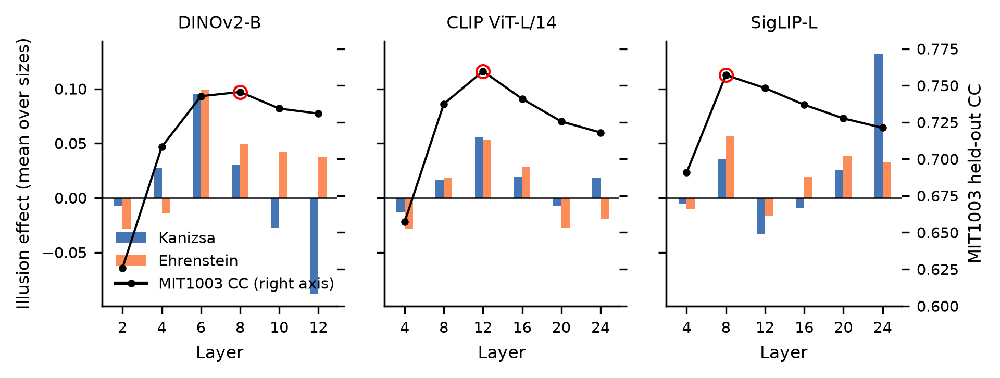

# Looking at Nothing

Code, stimuli and results for:

> Hamit Soyel. **Looking at Nothing: Only Two of Six Saliency Models Shift Attention Toward
> Illusory Figures, and the Feature Layer They Read Decides.** Under review.

## The result in one paragraph

In free viewing, people spend more time inside a Kanizsa square or an Ehrenstein disc than inside
the same inducers rearranged so that no figure appears (Kavšek, 2024). We rendered 960 controlled
displays (Kanizsa squares and triangles at six support ratios; Ehrenstein figures with 4 to 24
lines), each in illusory, real-contour and control versions, and measured the share of predicted
saliency inside the figure rather than on the inducers. **Only DeepGaze IIE and DeepGaze MSDB**
place more saliency inside the illusory figure than inside the primary control on both illusions
(**87% to 100%** of 120 configurations per illusion), and their Kanizsa effect grows with support
ratio. Even they reach an illusion index of **0.27 to 0.46**, against **0.82 to 0.86** for people.
A readout of the last layer of a frozen DINOv2 network **reverses** the Kanizsa effect in 97% of
configurations. Identical readouts on 18 layers of DINOv2, CLIP and SigLIP show that the earliest
layer never produces the effect, the layer that best predicts real fixations produces it on both
illusions in every network, and across layers the Ehrenstein effect tracks fixation accuracy
(**Spearman ρ = .71, p = .001**).

| Model | Kanizsa Δ (vs 180°) | % configs | Ehrenstein Δ (vs control B) | % configs |
|---|---:|---:|---:|---:|
| DeepGaze IIE | +0.089 | 100 | +0.052 | 97 |
| DeepGaze MSDB | +0.070 | 100 | +0.027 | 87 |
| xSoyelNet-ML (DINOv2 blocks 6+10) | −0.022 | 17 | +0.038 | 84 |
| MSI-Net | −0.017 | 22 | +0.002 | 40 |
| xSoyelNet-ASPP (DINOv2 last layer) | −0.144 | 3 | −0.019 | 37 |
| Spectral residual | −0.036 | 17 | −0.011 | 25 |
| Edge-energy null | −0.063 | 0 | −0.023 | 0 |

Δ = share of saliency inside the figure (illusory) minus the same share for the control.
The Ehrenstein primary control (control B, lines rotated about their inner ends) was chosen before
any model was run, by the rule that the edge-energy null must not favour the illusion against it.



## Reproduction

Every number in the paper is produced by `paper_stats.py` from the files in `results/`:

```bash
pip install -r requirements.txt
python paper_stats.py          # -> results/stats.json (all manuscript numbers)
python make_figures.py 2 3 4 5 # -> figures/ (figure 1 runs the models, see below)
```

Regenerating the raw results:

```bash
# 1. Stimuli (already in stimuli/; regenerating gives byte-identical images)
python stimuli_kanizsa.py
python stimuli_ehrenstein.py

# 2. Model scores -> results/<set>/results_<model>.json
python score_models.py kanizsa "DeepGaze IIE" "DeepGaze MSDB" "Spectral residual" "Edge-energy null"
python score_models.py ehrenstein "DeepGaze IIE" "DeepGaze MSDB" "Spectral residual" "Edge-energy null"
python msinet_maps.py kanizsa      # TensorFlow environment; then: python score_models.py kanizsa MSI-Net

# 3. Layer analysis with the released readouts (download below into weights/layers/)
python layer_sweep.py dinov2 eval  # MIT1003 held-out + Kanizsa  -> results/layers/dinov2/sweep_results.json
python layer_sweep.py dinov2 ehr   # Ehrenstein                  -> results/layers/dinov2/ehr_results.json
# same for clip and siglip

# 4. Training from scratch (needs SALICON, MIT1003 and CAT2000; set SAL_DATA or edit common.py)
python prepare_data.py
python layer_sweep.py dinov2 train # 6 readouts, 6 epochs, 336 px
python train_ml.py                 # xSoyelNet-ML recipe (DINOv2 blocks 6 + 10)
```

**Weights.** The 18 layer readouts (DINOv2-B blocks 2 to 12, CLIP ViT-L/14 and SigLIP-L layers 4
to 24) are attached to the [v1.0 release](https://github.com/Deep-c-Vision-LTD/looking-at-nothing/releases/tag/v1.0)
as `layer_readouts.zip`; unzip it in the repository root to get `weights/layers/<backbone>/readout_L<L>.pt`.
The xSoyelNet-ASPP and xSoyelNet-ML readout weights are not distributed; their per-image scores are in
`results/`, and `train_ml.py` reproduces the xSoyelNet-ML recipe.

**Pitfalls.**
- `hidden_states[L]` in Hugging Face is the output of block L *before* the final layer norm, so
  `hidden_states[12]` of DINOv2-B differs from `last_hidden_state`. xSoyelNet-ASPP reads
  `last_hidden_state`; the layer analysis reads `hidden_states`.
- DeepGaze MSDB: do not chain `.eval()` on the constructor; run it at half resolution with
  `pixel_per_dva = 17.5` as in `models.py`, and pass `dataset=None` for the averaged parameters.
- No model gets a centre-bias prior (figure position is varied); readouts are scored with their
  learned centre bias switched off.

## Repository layout

```
common.py              paths, inside-share measure, ASPP readout, metrics, MIT1003 split
stimuli_kanizsa.py     480 Kanizsa displays (2 shapes x 6 support ratios x 2 polarities x 5 positions x 4 versions)
stimuli_ehrenstein.py  480 Ehrenstein displays (6 line counts x 2 radii x 2 polarities x 5 positions x 4 versions)
models.py              DeepGaze IIE, DeepGaze MSDB, xSoyelNet-ASPP, xSoyelNet-ML, spectral residual, edge null
msinet_maps.py         MSI-Net maps (TensorFlow)
score_models.py        per-image scores for a stimulus set
prepare_data.py        training set (SALICON + MIT1003[:-200] + CAT2000) and fixation maps
layer_sweep.py         per-layer readouts: training, MIT1003 evaluation, Kanizsa and Ehrenstein scoring
train_ml.py            xSoyelNet-ML training recipe
paper_stats.py         every number in the paper -> results/stats.json
make_figures.py        paper figures
stimuli/               the 960 images with their inside / inducer masks (*_aoi.npz) and items.json
results/               per-image scores for every model, layer and input size
```

## License and data

Code: MIT (see `LICENSE`). Stimuli and results: CC BY 4.0. Training images and fixation data
(SALICON, MIT1003, CAT2000) are not redistributed; obtain them from their original sources.
The human reference values are taken from Kavšek (2024), *Attention, Perception, & Psychophysics*,
86(7), 2490–2503, https://doi.org/10.3758/s13414-023-02832-z.
