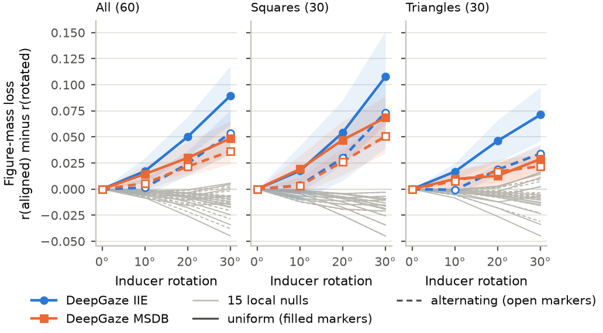

# Looking at Nothing

Code, stimuli, per-image scores and the scripts behind every number, table and figure of:

> Hamit Soyel. **Looking at Nothing: The Features a Saliency Model Reads, Not Its Readout, Set the Sign of Its Kanizsa
> Effect.** Submitted, 2026.

```bibtex
@unpublished{soyel2026lookingatnothing,
  author = {Hamit Soyel},
  title  = {Looking at Nothing: The Features a Saliency Model Reads, Not Its Readout, Set the Sign of Its Kanizsa Effect},
  note   = {Submitted},
  year   = {2026}
}
```

## The result in one paragraph

People look longer inside an illusory Kanizsa figure than inside the same inducers rotated so that no figure appears.
On 60 Kanizsa configurations (540 displays, plus 360 alternating-rotation displays), only **DeepGaze IIE** and
**DeepGaze MSDB** of six saliency models place more saliency inside the illusory figure than inside both rotated-inducer
controls (against the 180° control **+0.098** [0.072, 0.124] and **+0.075** [0.056, 0.095]), but a blurred Harris
corner detector gives a larger effect (**+0.176 to +0.241**), so the inside contrast alone does not show figural
processing. What separates both models from
all 15 local image nulls is their response to inducer alignment: a 20° rotation of every inducer leaves **0.49** (IIE) and
**0.60** (MSDB) of their effect while, pooled over shapes, no null loses figure mass, and on squares alternating the
rotation direction costs **0.55** and **0.56** of the uniform-rotation loss (nulls 1.00 to 1.02). In a readout swap
(4 frozen feature sets x 5 readouts from pointwise to full atrous pyramid pooling x 3 seeds, identical training),
every readout that met the fixation-accuracy criterion had the sign of its feature set (**14 of 14** cells,
**42 of 42** seed runs): negative on the last DINOv2-B block (-0.134 to -0.073), positive on DINOv2-B block 6 (+0.051 to
+0.090), the last SigLIP-L block (+0.113 to +0.144) and the convolutional features of DeepGaze IIE (+0.080 to +0.109).
Blocks 6 and 12 of one DINOv2 forward pass reach similar held-out MIT1003 CC under the same full-pyramid readout
(0.742 and 0.726) and opposite effects (**+0.090** and **-0.114**).

Effect = r(illusory) - r(control), where r = saliency mass inside the figure / (mass inside + mass on the inducers);
brackets are 95% cluster-bootstrap intervals over the 60 configurations. Every value above is a macro of
`paper_numbers/output/numbers.tex`, where a comment names the result file and JSON path it comes from.



## Reproduction

Python 3.12. Every script runs from the repository root; locations are set in `paths.py` (repository-relative
defaults, environment variables for external data and weights, see below).

```bash
git clone https://github.com/Deep-c-Vision-LTD/looking-at-nothing && cd looking-at-nothing
python3.12 -m venv .venv && . .venv/bin/activate && pip install -r requirements.txt
```

**1. Numbers, tables and figures from the distributed results** (seconds; no model is run):

```bash
paper_numbers/build.sh       # -> paper_numbers/output/: numbers.tex, numbers_extra.tex, tab_readout.tex,
                             #    tab_survey.tex, tab_sweep.tex, make_numbers.log, figs/fig1..fig4 (.pdf, .png)
python tools/smoke_test.py   # re-renders sample stimuli and compares bytes, rescores 2 images with the edge-energy
                             # null, spectral residual and the 15 local nulls, re-derives numbers.tex and compares every macro
```

**2. Stimuli.** The generators reproduce `stimuli/` byte for byte; the verifiers re-render every display, compare it
with the saved PNG and with the first-version renderers, and check the AOIs.

```bash
python stimuli/stimuli_v3.py && python stimuli/verify_stim_v3.py     # 740 displays + AOIs  -> stimuli/stim_v3
python stimuli/stimuli_alt.py && python stimuli/verify_stim_alt.py   # 360 displays + AOIs  -> stimuli/stim_alt
(cd stimuli && shasum -a 256 -c SHA256SUMS)
```

**3. Data, weights and the training cache** (needed from step 4 on):

```bash
export SAL_DATA=/path/to/data        # mit1003/{ALLSTIMULI,ALLFIXATIONMAPS}, salicon/{images/train,train}
export CAT2000=/path/to/cat2000      # Stimuli/, FIXATIONMAPS/, FIXATIONLOCS/ (default: $SAL_DATA/cat2000)
curl -L -O https://github.com/Deep-c-Vision-LTD/looking-at-nothing/releases/download/v1.0/layer_readouts.zip
unzip layer_readouts.zip             # -> weights/layers/<dinov2|clip|siglip>/readout_L<L>.pt (18 layer-sweep readouts)
python models/ab_objective.py cache  # -> work/train_cache/{meta.json, maps.npy}: the 12,803 training images
```

Pretrained backbones (facebook/dinov2-base, openai/clip-vit-large-patch14, google/siglip-large-patch16-256,
alexanderkroner/MSI-Net) and the DeepGaze checkpoints download on first use; the scripts default to offline mode once
they are cached, so run the first job with `HF_HUB_OFFLINE=0 TRANSFORMERS_OFFLINE=0`.

**4. Per-image scores** (CPU, 3 threads per process; DeepGaze MSDB takes about 30 s per image on 3 threads):

```bash
python scoring/score_v3.py edge sr iie msdb          # stim_v3 -> results/v2/scores/raw/<tag>.json
for b in dinov2 clip siglip; do python scoring/score_v3.py sweep:$b; done     # one process per backbone
python scoring/score_v3.py aspp ml                    # xSoyelNet-ASPP and -ML: needs their weights (not distributed)
python scoring/run_msinet_v3.py                       # in a TensorFlow 2 / Keras 3 environment, then:
python scoring/score_v3.py msinet
python scoring/local_nulls.py                         # 15 local nulls on stim_v3 -> results/v2/verify
python scoring/fill_contrast_iie.py                   # DeepGaze IIE at 25 % and 75 % fill contrast
python scoring/score_alt.py iie msdb                  # stim_alt -> results/v3/scores/raw/<tag>.json
for b in dinov2 clip siglip; do python scoring/score_alt.py sweep:$b; done
python scoring/measure_v3maps.py                      # core measures from the saved stim_v3 maps
python scoring/local_nulls_alt.py                     # local nulls on stim_v3 and stim_alt
```

`SCORE_SHARD=i/n` splits a scoring run over processes (`python scoring/score_v3.py merge <tag>` joins the shards).
The `sweep:<backbone>` keys must run in separate processes (the sweep module binds its backbone at import).

**5. Statistics:**

```bash
python analysis/analyze_v3.py          # survey, misalignment ratios, illusion indices -> results/v2/scores/results.json
python analysis/analyze_alt.py         # uniform vs alternating rotation, core AOI, support-ratio slopes, nulls
                                       #   -> results/v3/scores/results.json
python analysis/local_nulls_stats.py && python analysis/position_check.py && python analysis/fill_contrast_stats.py
CORE_D=30 CORE_OUT=results/v2/verify/core_aoi_D30_835295.json python analysis/core_aoi.py DeepGaze_IIE DeepGaze_MSDB \
    xSoyelNet-ASPP xSoyelNet-ML MSI-Net Edge-energy_null L:dinov2_L12 L:dinov2_L8 L:siglip_L24 L:clip_L12
for n in dinov2 clip siglip; do for s in 336 448; do python analysis/encoding/run_vit.py $n $s; done; done
python analysis/encoding_nulls.py      # readout-free token encoding against a near-exterior null
```

**6. Shapley decomposition** of DeepGaze IIE (4 backbones) and DeepGaze MSDB (feature tensors, backbones, scales):

```bash
python decomposition/run_iie.py && python decomposition/run_msdb.py && python decomposition/run_lesion.py
python decomposition/run_ml.py         # xSoyelNet-ML comparison (needs its weights)
python decomposition/analyze.py        # -> results/v2/decompose/results.json
```

**7. Readout swap** (60 readouts; the published run used Apple MPS):

```bash
V3_DEVICE=mps readout_swap/run_full.sh      # or cuda / cpu; stats, training, evaluation, results_full.json
python paper_numbers/check_seed_bootstrap.py
```

The design is in `readout_swap/README.md`. To evaluate the released checkpoints (release v2.0) instead of training,
download them into `results/v3/gpu/full/ckpt/`, mark them as trained and run the evaluation and analysis:

```bash
curl -L -O https://github.com/Deep-c-Vision-LTD/looking-at-nothing/releases/download/v2.0/readout_swap_checkpoints.zip
unzip readout_swap_checkpoints.zip -d results/v3/gpu/full/   # creates ckpt/ (SHA-256 4af4114c...)
mkdir -p results/v3/gpu/full/done
for f in results/v3/gpu/full/ckpt/*.pt; do date > results/v3/gpu/full/done/train_$(basename $f .pt); done
for b in dinov2 siglip iie; do python readout_swap/eval_full.py --bb $b --force; done
python readout_swap/analyze_full.py
```

**8. Training recipes of the readouts that the swap and the survey reuse** (they write into `weights/`; set
`LAN_WEIGHTS` to another folder to keep the released files):

```bash
python models/sweep.py dinov2 train && python models/sweep.py dinov2 eval   # also clip, siglip (Appendix B readouts)
python models/ab_layers.py train                                            # xSoyelNet-ML recipe -> weights/readout_M610.pt
```

**Pitfalls.**
- Hugging Face `hidden_states[L]` is the output of block L (1-based) before the final layer norm. The layer sweep and
  the readout swap read `hidden_states`; xSoyelNet-ASPP reads `last_hidden_state` (after the final layer norm);
  xSoyelNet-ML reads `hidden_states[7]` and `[11]`, the 0-based blocks 6 and 10 that DeepGaze MSDB reads.
- DeepGaze MSDB: do not chain `.eval()` on the constructor; it runs on a 512 x 384 input at `pixel_per_dva = 17.5` with
  `dataset=None` (dataset-averaged parameters). Both DeepGaze models get a uniform centre bias; every learned centre
  bias is switched off on the illusion displays, because figure position is varied.
- Per-image score files are stored as `<name>.json.xz` (`xz -dk` to read them by hand). Scripts read a plain
  `<name>.json` first, so a rerun replaces the distributed file without deleting it.
- `analysis/core_aoi.py` names its output with a hash of the tag list that changes between processes; set `CORE_OUT`.
- Saliency maps, feature caches and training states are not distributed. Analyses that read maps (the float16 map
  check of `analyze_v3.py`, `core_aoi.py`, the IIE path-alone effects of `decomposition/analyze.py`) need the scoring
  step that writes them; everything else runs from the files in `results/`.
- `results/v2/anatomy/anatomy.json` (parameter counts, channels, blur scales, training data of every model) cites
  file:line evidence in the project tree in which it was compiled; the cited scripts are the files of the same name in
  `models/`, `scoring/`, `analysis/` and `readout_swap/`, with paths made configurable. The DeepGaze facts are
  measured by `analysis/anatomy/inspect_deepgaze.py`.

## Not redistributed

| What | Where to get it |
|---|---|
| MIT1003 (Judd et al., 2009) | https://people.csail.mit.edu/tjudd/WherePeopleLook/ |
| SALICON (Jiang et al., 2015) | http://salicon.net/ |
| CAT2000 (Borji & Itti, 2015) | http://saliency.mit.edu/results_cat2000.html |
| DeepGaze IIE and MSDB weights | downloaded by deepgaze_pytorch (https://github.com/matthias-k/DeepGaze) |
| MSI-Net weights | https://huggingface.co/alexanderkroner/MSI-Net |
| DINOv2-B, CLIP-L/14, SigLIP-L/16 | Hugging Face model hub (names above) |
| xSoyelNet-ASPP and xSoyelNet-ML weights | not distributed (commercial models); their per-image scores are in `results/` and `models/ab_layers.py` holds the xSoyelNet-ML training recipe |
| 18 layer-sweep readouts (302 MB) | release v1.0, `layer_readouts.zip` |
| 60 readout-swap checkpoints (591 MB, 548 MB zipped) | release v2.0, `readout_swap_checkpoints.zip`, to unzip into `results/v3/gpu/full/` |
| Saliency maps, feature caches, token caches, training states | regenerated by the scripts (tens of GB) |

The human reference values are computed from the pooled dwell proportions of Kavšek, M. (2024). Perception of illusory
contours in children and adults: An eye-tracking study. *Attention, Perception, & Psychophysics, 86*, 2490-2503,
https://doi.org/10.3758/s13414-023-02832-z; no eye-movement data were collected for this study.

## Repository layout

```
paths.py                 single configurable root: results, stimuli, work, weights, data (environment variables)
stimuli/                 generators, verifiers and the rendered sets
  stimuli_v3.py            740 displays: Kanizsa 60 configurations x 9 conditions, Ehrenstein 40 x 5
  stimuli_alt.py           360 alternating-rotation displays (60 configurations x 3 angles x 2 phases)
  stimuli_v2.py, stimuli_ehr.py   first-version renderers that stimuli_v3.py builds on
  verify_stim_v3.py, verify_stim_alt.py, contact_stim_v3.py
  stim_v3/, stim_alt/, fill_variants/   PNGs, AOIs (*_aoi.npz), items.json, verify.json; SHA256SUMS
models/                  model code shared by every step
  gate_kanizsa.py          inside-share measure r; xSoyelNet-ASPP, DeepGaze IIE and MSDB loaders
  run_v2.py                spectral residual, edge-energy null, xSoyelNet-ML builder
  ab_objective.py          training set (12,803 images), DINOv2 backbone, loss KL + 2(1 - CC)
  ab_layers.py, scales.py  xSoyelNet-ML readout, training recipe and test-time averaging
  sweep.py                 layer sweep: one R4 readout per block of DINOv2-B, CLIP-L/14, SigLIP-L/16
  msinet_maps.py           MSI-Net maps (TensorFlow)
  src/                     ASPP module and readout, saliency metrics, MIT1003 split
scoring/                 per-image scores of models and local nulls (score_v3.py, score_alt.py, local_nulls*.py, ...)
analysis/                survey, rotation, core-AOI, position, fill-contrast and encoding statistics
decomposition/           exact Shapley decompositions of DeepGaze IIE and MSDB
readout_swap/            full-data readout swap (fullcommon, stats, train, eval, analyze, run_full.sh); pilot/ = shared
                         readout definitions and the 3,000-image pilot
paper_numbers/           make_numbers.py, make_numbers_extra.py, check_seed_bootstrap.py, make_figures.py, build.sh
  tab_anatomy.tex          Table 1, written by hand; every number in it is a macro of the generated files
  output/                  numbers.tex (every number with its source), numbers_extra.tex, tab_readout.tex,
                           tab_survey.tex, tab_sweep.tex, make_numbers.log, figs/
results/                 result files, in the tree that the source comments of numbers.tex name
  v2/scores/               survey results.json and per-image scores raw/*.json.xz
  v2/verify/               local nulls, core AOI, positions, fill contrast, encoding nulls
  v2/decompose/            Shapley results.json and per-image hybrid scores
  v2/anatomy/              anatomy.json (model facts behind Table 1)
  v2/conventions.md        configuration counts and the human sample, read by make_numbers.py
  v3/scores/               rotation and core results.json.xz, per-image scores, local nulls, logs in v3/logs/
  v3/gpu/full/             readout swap: results_full.json, report_full.md, per-image scores, R1n statistics,
                           training records (ckpt/*.json)
  paper/seed_bootstrap.json  two-level seed bootstrap of the readout-swap intervals
tools/smoke_test.py      quick end-to-end check (stimuli bytes, two-image rescoring, numbers)
legacy/                  first version of the study (960 displays); its stimuli and scores serve as references
```

## License and data

Code: MIT (see `LICENSE`). Stimuli, per-image scores and results: CC BY 4.0. Benchmark images and fixation data are
not redistributed; only derived quantities (scores, statistics) are.
